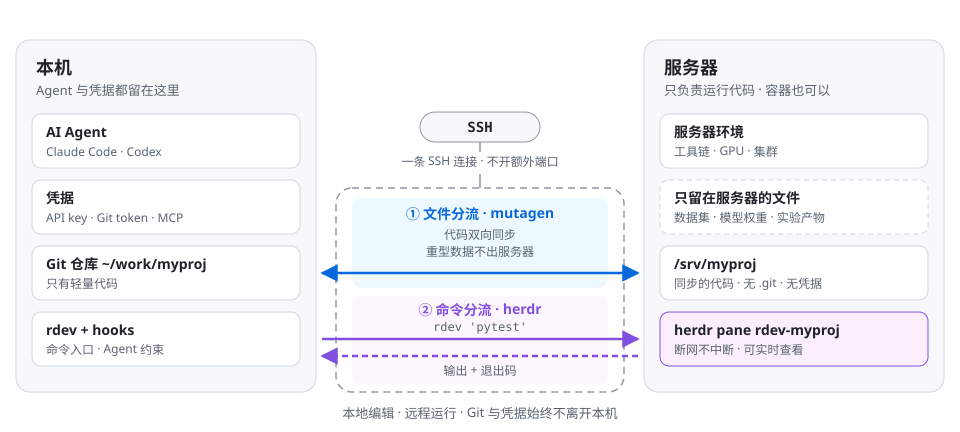

# agent-over-ssh

**AI 编程 Agent 和凭据留在本机，服务器只负责运行代码，两者之间只走 SSH。**

[](https://github.com/changingxsy/agent-over-ssh/actions/workflows/ci.yml)
[](LICENSE)

[English](README.md) · 简体中文

## 痛点

**服务器经常换，每换一台都要重新配一遍 Agent。** 科研和开发通常在服务器上进行：实验室 GPU 机、学校集群、云主机，而且经常更换。让 Claude Code 或 Codex 直接在每台服务器上工作，就得反复安装、登录，再把 API key、Git 凭据、MCP、技能和各种偏好重新配一遍。有的服务器根本连不上外网，Agent 在上面完全用不了。在共享服务器上，凭据还会放在其他用户和管理员能接触到的地方。

**容器限制端口，端口转发方案用不了。** 很多开发环境跑在容器里，不能开放或转发额外端口，基于端口转发的远程 Agent 方案就失效了。而 SSH 几乎是每台服务器都有的入口：只要能登录，就一定能用。

## 方案

Agent 连同它的全部配置都留在本机，服务器只是执行端，两者之间只用一条 SSH 连接：不做端口转发，也不开额外端口。

<picture>
  <source media="(prefers-color-scheme: dark)" srcset="docs/assets/architecture.zh-CN-dark.svg">
  
</picture>

本质上是**两个层面的分流**：

- **文件分流。** [mutagen](https://mutagen.io) 只在本机和服务器之间同步轻量的代码。数据集、模型权重、checkpoint、实验产物都留在服务器上，不会映射到本机，大大减少了本地占用的空间。
- **命令分流。** Agent 在本地改代码，通过 `rdev` 把服务器上的命令交给常驻的 [herdr](https://herdr.dev) pane 执行。长任务不受 Agent 工具调用的超时限制，断网或合上笔记本也会继续运行；你也可以随时打开这个 pane，看到命令在服务器上实际做了什么。

| 组件 | 作用 |
|---|---|
| mutagen | 通过 SSH 双向安全同步文件，只留在服务器的路径不参与同步 |
| herdr | 通过 SSH 连接的服务器常驻 pane |
| `rdev` | 服务器命令的唯一入口：先刷新同步，再在 pane 中运行，传回输出和远程退出码 |
| `remote-dev-init` | 初始化项目，或把服务器上已有的 Git 项目迁移到本机 |
| hooks + 技能 | 让 Claude Code / Codex 遵循这套流程：注入同步状态、提示冲突、拦截直接 `ssh` 到开发机 |

Git 只在本机；服务器上没有 `.git`，也没有任何凭据。

## 快速上手

**依赖：** macOS（已测试）或 Linux（未测试），需要 `bash`、`jq`、`perl` 和 OpenSSH；在 `~/.ssh/config` 中配好服务器别名；本机安装 [mutagen](https://mutagen.io/documentation/introduction/installation) 和 [herdr](https://herdr.dev)。服务器只需要 SSH 和 `bash`。

**1. 安装**

```bash
git clone https://github.com/changingxsy/agent-over-ssh.git ~/src/agent-over-ssh
~/src/agent-over-ssh/install.sh
herdr machine add devbox            # 每台服务器执行一次
```

`install.sh` 把 `rdev` 和 `remote-dev-init` 软链接到 `~/.local/bin`，把 Agent 技能链接到 `~/.claude/skills` / `~/.codex/skills`，不会覆盖已有文件。

**2. 创建项目**：先预览，并列出只留在服务器的路径：

```bash
remote-dev-init --host devbox --remote /srv/myproj --stack python \
  --ignore /data --ignore /checkpoints --ignore /outputs --plan
remote-dev-init --host devbox --remote /srv/myproj --stack python \
  --ignore /data --ignore /checkpoints --ignore /outputs
```

**3. 在服务器上运行**

```bash
cd ~/work/myproj
rdev 'pytest'                        # 运行并等待，退出码与远程一致
rdev --bg 'python train.py'          # 长任务：立即返回一个 TOKEN
rdev --wait TOKEN --timeout 540      # 收取结果，断网之后也可以
rdev up                              # 检查并修复同步、pane，列出未收取的任务
```

**4. 接入 Agent**：把 [`examples/claude-settings.hooks.json`](examples/claude-settings.hooks.json) 合并进 `~/.claude/settings.json`，和/或把 [`examples/codex-hooks.json`](examples/codex-hooks.json) 合并进 `~/.codex/hooks.json`，并替换其中的 `/path/to/agent-over-ssh`。之后在任何带有 `.remote-dev.toml` 的项目里，Agent 都会在本地改代码，并用 `rdev` 运行服务器命令。

## 文档

| | |
|---|---|
| [架构](docs/zh-CN/architecture.md) | 为什么只用 SSH，凭据和 Git 放在哪里 |
| [文件分流](docs/zh-CN/file-sync.md) | 哪些文件同步、只留服务器的路径、冲突处理、迁移服务器上的仓库、构建元数据 |
| [命令分流](docs/zh-CN/command-routing.md) | `rdev` 每一步做什么、长任务、断网、退出码 |
| [Agent 集成](docs/zh-CN/agent-integration.md) | hooks、技能、主 Agent 与委派 Agent、自定义拦截规则 |
| [参考](docs/zh-CN/reference.md) | `rdev` 和 `remote-dev-init` 的全部参数、`.remote-dev.toml` |
| [常见问题](docs/zh-CN/faq.md) | 与 VS Code Remote-SSH、在服务器上装 Agent、sshfs/rsync 的对比 |

## 许可证

[MIT](LICENSE)
