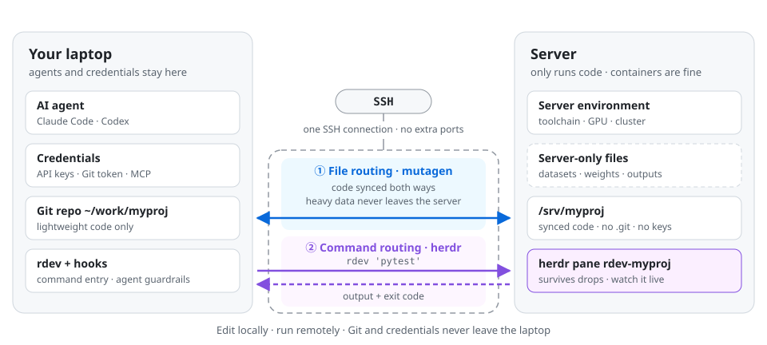

# Architecture

English · [简体中文](zh-CN/architecture.md) · [Docs index](../README.md#documentation)

agent-over-ssh splits development across two machines joined by one SSH connection. The laptop is where you and your agent *think and edit*; the server is where code *runs*.

<picture>
  <source media="(prefers-color-scheme: dark)" srcset="assets/architecture-dark.svg">
  
</picture>

## Why SSH only

Both channels piggyback on SSH instead of opening their own:

- **mutagen** starts a small agent binary on the server over SSH and syncs files through that session's stdin/stdout.
- **herdr** likewise reaches its server-side process over SSH; `rdev` talks to the pane through the herdr CLI, and to the run directory through plain `ssh`.

So nothing listens on a new port, nothing is forwarded, and no reverse tunnel is needed. That is what makes it work in containers that only expose `sshd`, behind firewalls that drop everything but port 22, and on machines without outbound internet: the helper binaries are deployed from the laptop over SSH (by mutagen itself and by `herdr machine add`), not downloaded by the server.

## Where things live

| | laptop | server |
|---|---|---|
| agent (Claude Code / Codex), its login, MCP, skills | ✓ | |
| API keys, Git / GitHub tokens | ✓ | |
| Git repository (`.git`) | ✓ | |
| project code | ✓ | ✓ (synced copy) |
| datasets, weights, checkpoints, outputs | | ✓ (server-only) |
| `.remote-dev.toml`, `.remote-dev.ignores` | ✓ (excluded from Git) | |
| run scripts, logs, exit codes (`~/.rdev/run/<name>/`) | | ✓ |
| job records, pane cache (`~/.cache/rdev/`) | ✓ | |
| herdr workspace `rdev-<name>` | | ✓ |
| mutagen / herdr helper binaries | ✓ | ✓ (no credentials) |

On a shared server, other users and admins can see your code and outputs (as with any remote work), but never your keys or tokens.

## Why Git stays on the laptop

- **One source of truth.** The server has no `.git`, so there is nothing to diverge, and Git cannot accidentally run there.
- **Credentials stay local.** Pushing needs a token; keeping Git local means the token never travels.
- **Version info still reaches the server.** Every `rdev` run injects `VERSION`, `COMMIT`, … from the local repo, and a synced `.build-meta.json` covers builds started some other way. See [File routing → Build metadata](file-sync.md#build-metadata-without-git-on-the-server).

## Design principles

- **Never run on stale code.** `rdev` waits for the sync to connect and flushes it before every run; it refuses to run when the sync is offline or has conflicts.
- **Never lose a running job.** Commands run in a server-side pane and record their log and exit code on the server, so a network drop on the laptop does not kill them.
- **Never re-run blindly.** Each run gets a token; after a disconnect you collect the same run with `rdev --wait TOKEN`, and hooks remind the agent about uncollected jobs.
- **Every external call is bounded.** ssh, mutagen and herdr calls all have timeouts (via a small perl `alarm` wrapper, since macOS has no `timeout(1)`), so nothing hangs forever.
- **Setup is idempotent and reversible.** `remote-dev-init` can be re-run after any interruption, `--plan` is read-only, and migrating a server repo renames its `.git` instead of deleting it.
- **The agent is guided, not trusted blindly.** Hooks inject the rules and live status, and hard-block the two mistakes that matter most (see [Agent integration](agent-integration.md)).
